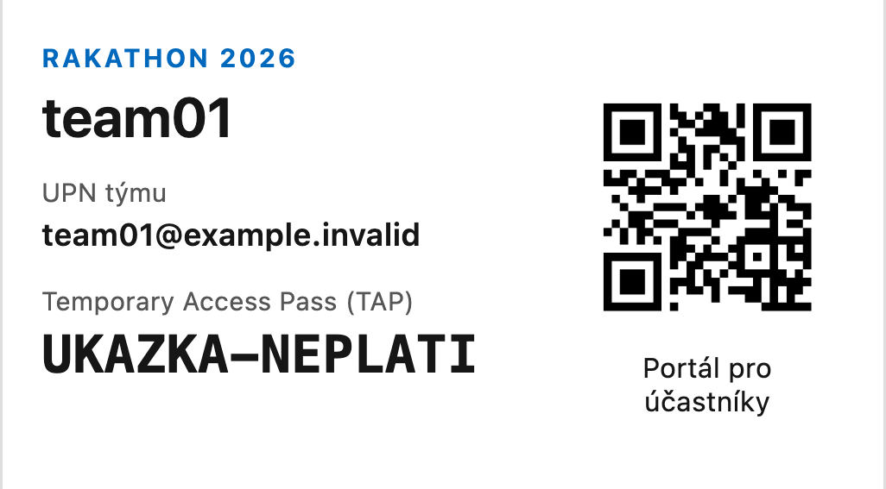
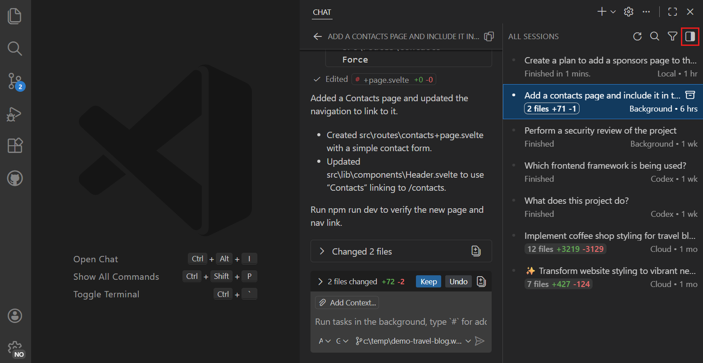
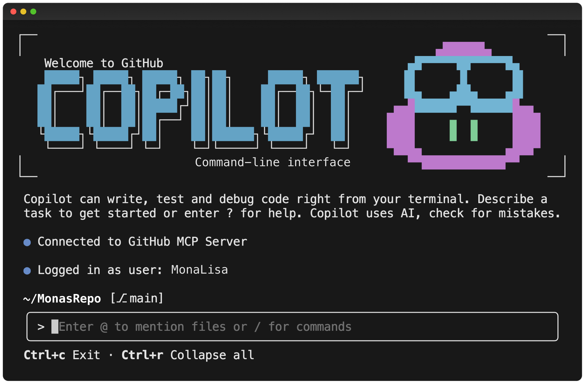
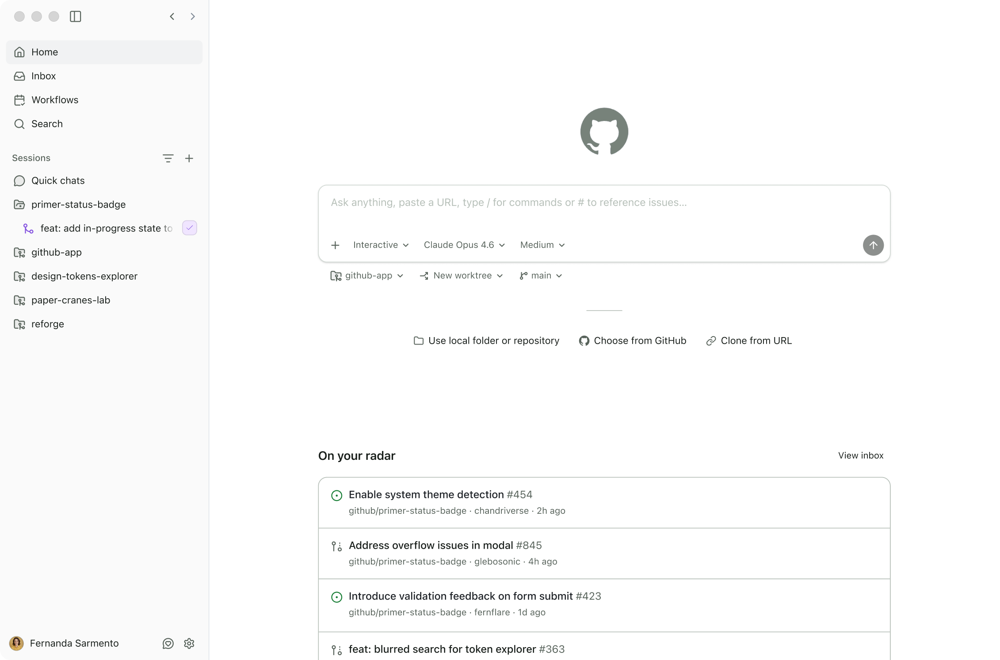
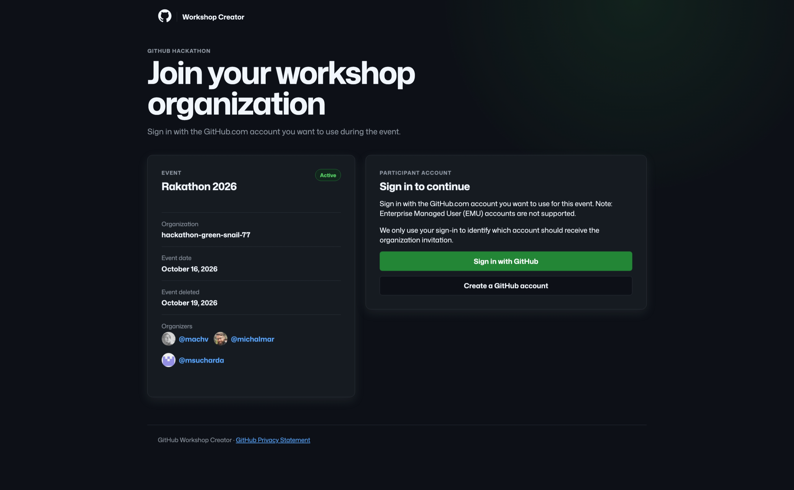

# Rakathon: průvodce pro nové účastníky

Přihlaste se týmovým účtem, zkopírujte si API klíč a vyzkoušejte první volání modelu.

## 00 Co pro vás máme


**Azure:** pro každý tým vlastní prostředí v Azure: resource group, kde můžete své řešení vytvářet a nasazovat.


**GitHub:** pro každého účastníka možnost využít GitHub Copilot s placenou licencí a připraveným kreditem.

## Otevřete portál pro účastníky

**Portál pro účastníky:** <https://aka.ms/rakathon2026>

[](https://aka.ms/rakathon2026)

Naskenujte QR kód nebo otevřete URL výše a přihlaste se přiděleným týmovým účtem.

**Prezentace:** otevřete [newcomer-guide.standalone.html](newcomer-guide.standalone.html) v prohlížeči a zvolte **Prezentace**. Stejný soubor obsahuje i úplného průvodce pro čtení a funguje offline. Pro otevření portálu nebo volání Azure potřebujete připojení k internetu.

## Co může váš tým využít

| Prostředek | Co vám poskytne | Kde začít |
|---|---|---|
| Portál pro účastníky | Týmový API klíč, názvy deploymentů modelů, URL gateway a seznam datových souborů | Portál pro účastníky výše |
| AI gateway | Sdílené modely pro text a kód i deployment pro generování obrázků; přístup přes týmový klíč | Portál: **Váš API klíč** a **Modely** |
| Data k výzvám | Datové soubory pro výzvy VZP, pouze pro čtení | Portál: **Datové podklady pouze pro výzvy VZP** |
| Týmové prostředí | Azure resource group `rg-teamNN`, kde má tým roli Contributor | <https://portal.azure.com/>: **Resource groups** |

`teamNN` označuje váš přidělený tým, například `team01`. Týmové prostředí není samostatná subscription: spravujte pouze vlastní resource group. Týmy nemají přímý přístup do portálu Microsoft Foundry ani ke službě Agent Service.

Seznamy modelů a souborů jsou snapshoty: v portálu zkontrolujte datum **Stav k**. Průvodce vychází z konfigurace repozitáře ověřené 12. října 2026; nejde o živý přehled ani záruku dostupnosti.


Screenshot portálu dodaný pro tohoto průvodce má skryté identifikátory účtu a tenantu. Ukázka používá jiný než týmový účet, proto nezobrazuje API klíč. Vlastní klíč uvidíte po přihlášení přiděleným týmovým účtem.

## Jak získáte týmový účet: tištěná kartička

Organizátoři plánují předat každému týmu fyzickou kartičku ve formátu vizitky. Vlevo bude **UPN** (celé přihlašovací jméno týmu) a **TAP** (Temporary Access Pass), vpravo QR kód odkazující na <https://aka.ms/rakathon2026>.



Ukázka skutečného tiskového rozvržení kartičky **90 × 50 mm** s nahrazenými údaji. **UPN i TAP jsou fiktivní a neplatné; nejde o použitelnou přístupovou kartičku.** QR kód skutečně otevírá portál pro účastníky.

1. U organizátorů převezměte kartičku svého týmu a ověřte, že vám patří. Ukázkové údaje z tohoto průvodce nepoužívejte.
2. Naskenujte QR kód. Otevře pouze portál, nepřihlásí vás automaticky a neobsahuje UPN ani TAP. Při přihlášení k Microsoftu zadejte celé UPN z kartičky a použijte její TAP.
3. Kartičku chraňte: obsahuje přihlašovací údaje. Nefotografujte ji pro veřejné sdílení, nedávejte ji do Gitu ani veřejného chatu. Platnost TAP si ověřte u organizátorů; při ztrátě kartičky nebo nefunkčním TAP je kontaktujte.

TAP není API klíč. Týmový API klíč si zkopírujete až po přihlášení v sekci **Váš API klíč**. Soukromý soubor `teamNN.md`, pokud vám jej organizátoři poskytnou, může sloužit jako záložní předání údajů.

## Přihlaste se účtem od organizátorů

1. Připravte si týmovou kartičku s UPN a TAP a ověřte si platnost TAP. Pokud dostanete i záložní soubor `teamNN.md`, uchovávejte ho stejně bezpečně jako kartičku; nedávejte ho do Gitu ani nesdílejte mimo tým.
2. Naskenujte QR z kartičky nebo otevřete <https://aka.ms/rakathon2026>. Pokud jste u Microsoftu již přihlášeni osobním nebo pracovním účtem, použijte samostatný profil prohlížeče nebo anonymní okno.
3. Zadejte celé UPN z kartičky, nikoli svůj běžný účet. Při přihlášení k Microsoftu použijte TAP a postupujte podle případných pokynů k nastavení ověřování.
4. V portálu zkontrolujte přihlášeného uživatele. Klíč musí patřit stejnému týmu `teamNN`.

TAP slouží k přihlášení k Microsoftu; **není to** API klíč pro modely. Funguje pouze v době platnosti potvrzené organizátory a může být jednorázový. Pokud vypršel, ještě neplatí, byl již použit nebo nelze přihlášení dokončit, požádejte organizátory o pomoc.

## Zkopírujte si týmový klíč

1. Otevřete sekci **Váš API klíč**.
2. Zkontrolujte správný tým a stav **aktivní**.
3. Klikněte na ikonu kopírování u **API klíč (hlavička api-key)**. Ikona oka hodnotu zobrazí nebo skryje.
4. Zkopírujte **Base URL (OpenAI v1)**. V sekci **Modely** rozbalte kartu modelu a zkopírujte **Deployment / model v SDK**.

Stejný týmový klíč funguje pro všechny deploymenty modelů na gateway. Uložte jej jako lokální secret, proměnnou prostředí nebo do serverového úložiště tajných údajů aplikace. Nikdy jej necommitujte, nevkládejte do veřejného chatu, neukazujte na screenshotech ani nezapisujte do kódu v prohlížeči. Pokud portál klíč nenačte, požádejte organizátory o pomoc nebo použijte záložní API údaje ze soukromého předávacího souboru, pokud jej máte. TAP z kartičky API klíč nenahrazuje.

Gateway má adresu `https://apim-rakathon-q7146n.azure-api.net/openai/v1`. Klíč posílejte v **hlavičce `api-key`**; samotná hlavička `Authorization: Bearer` požadavky na gateway neověří. Nepoužívejte přímý endpoint Foundry.

## Připraveno je osm modelů od pěti poskytovatelů

| Poskytovatel | Připravené modely |
|---|---|
|  OpenAI | `gpt-6.1-sol`, `gpt-6-astra`, `gpt-6-luna` |
| **xAI** | `grok-4.7` |
|  DeepSeek | `DeepSeek-V4-Pro` |
|  Moonshot AI / Kimi | `Kimi-K2.7-Code` |
|  Microsoft AI | `MAI-Thinking-1`, `MAI-Image-2.5` |

Modely i značky poskytovatelů odpovídají katalogu účastnického portálu ze **14. října 2026**; všechny uvedené deploymenty v něm mají stav **Succeeded**. Jde o snapshot, nikoli živou kontrolu dostupnosti. Aktuální seznam a přesné názvy deploymentů ověřte v sekci **Modely** v [portálu pro účastníky](https://aka.ms/rakathon2026).

Modely používejte přes týmovou AI gateway. **MAI-Image-2.5** slouží ke generování obrázků; ostatní uvedené modely pracují s textem či kódem. Pro rozsah zpracování se řiďte označením **EU Data Zone / Global** u konkrétního deploymentu. Loga a wordmark xAI jsou převzaté ze stejného zobrazení jako v portálu.

## Vyzkoušejte krátké první volání modelu

V sekci **Modely** vyberte textový deployment. Hodnota `model` je **název deploymentu**, nikoli zobrazovaný název modelu. Například pro `gpt-6-luna` je nakonfigurován deployment `gpt-6-luna-dz-eu`; před použitím ověřte, že je v seznamu.

Příklad spusťte v **Bashi** s nainstalovaným `curl`. Zadávání klíče je skryté a jeho konkrétní hodnota se neuloží do historie příkazů:

```bash
export AZURE_CONFIG_DIR="$HOME/.azure-rak"
read -r -s -p "Týmový API klíč: " API_KEY; printf '\n'
export API_KEY
curl --fail-with-body --silent --show-error \
  https://apim-rakathon-q7146n.azure-api.net/openai/v1/chat/completions \
  -H "api-key: $API_KEY" \
  -H "Content-Type: application/json" \
  -d '{"model":"gpt-6-luna-dz-eu","messages":[{"role":"user","content":"Pozdrav náš tým na hackathonu."}]}'
unset API_KEY
```

Úspěšný požadavek vrátí JSON s odpovědí asistenta. Pokud jste vybrali jiný textový deployment, změňte hodnotu `model`.

Pro Python nainstalujte do prostředí projektu balíček `openai` a použijte skryté zadávání klíče:

```python
from getpass import getpass
from openai import OpenAI

client = OpenAI(
    base_url="https://apim-rakathon-q7146n.azure-api.net/openai/v1/",
    api_key="unused",
    default_headers={"api-key": getpass("Týmový API klíč: ")},
)
reply = client.chat.completions.create(
    model="gpt-6-luna-dz-eu",
    messages=[{"role": "user", "content": "Pozdrav náš tým na hackathonu."}],
)
print(reply.choices[0].message.content)
```

SDK vyžaduje parametr `api_key`; hodnota `"unused"` je pouze placeholder, nikoli přihlašovací údaj. Skutečný klíč gateway patří do `default_headers`.

Konfigurace zahrnuje modely OpenAI, xAI, DeepSeek, Moonshot AI / Kimi a Microsoft AI. Generování obrázků používá `/images/generations`, nikoli `/chat/completions`. Ne každý model podporuje všechna API a parametry. Podle označení **EU Data Zone** nebo **Global** vyberte rozsah zpracování povolený pro vaši výzvu. U Global nelze předpokládat zpracování pouze v Evropě.

## Datové podklady jsou pouze pro výzvy VZP

**Nejde o společná data pro všechny challenge hackathonu.** Tyto soubory jsou podklady pro výzvy VZP. Dostupnost v portálu neznamená oprávnění použít je v jiné výzvě. Podklady pro ostatní challenge řešte podle jejich zadání s garantem výzvy.

Portál obsahuje data pro **výzvy VZP**. Používejte je pouze tehdy, pokud se týkají vaší výzvy a máte jejich použití povolené.

1. V sekci **Datové podklady pouze pro výzvy VZP** zvolte **Otevřít storage v portálu**.
2. Do Azure Portal se přihlaste stejným týmovým účtem. V případě potřeby přepněte adresář na adresář akce uvedený organizátory.
3. Otevřete storage account `strakathondataq7146n`, poté **Containers / Kontejnery** > **data**.
4. Použijte ověřování **Microsoft Entra ID**, vyberte soubor a zvolte **Download / Stáhnout**.

Snapshot repozitáře z 9. října obsahuje `Rakathon_Datove_rozhrani.docx`, `Rakhaton2026.csv` a `Rakhaton2026.zip`. Aktuální publikovaný snapshot ověřte v seznamu souborů v portálu.

Portál pro účastníky nestahuje soubory ani negeneruje odkazy ke stažení. Přístup k datům v Azure je oddělený od přihlášení do portálu: vyžaduje role Reader a Storage Blob Data Reader i povolený síťový přístup k úložišti. Pokud přístup nefunguje, požádejte organizátory o kontrolu oprávnění i sítě. Nežádejte o klíče storage accountu ani neměňte nastavení sdíleného úložiště.

## Vyvíjejte ve vlastní týmové resource group

Na <https://portal.azure.com/> otevřete **Resource groups** a vyberte přidělenou `rg-teamNN`. Tým zde má roli Contributor, která umožňuje vytvářet a spravovat prostředky aplikace v této skupině v mezích Azure policies a dostupných kvót. Sdílená data jsou pouze pro čtení a skupiny ostatních týmů nejsou součástí vašeho prostředí.

Sdílená AI gateway je připravena k použití; kvůli volání modelů nemusíte nasazovat vlastní Foundry resource. Před vytvářením placených prostředků se domluvte s týmem a u organizátorů ověřte povolené služby a náklady na infrastrukturu. Níže uvedený rozpočet modelového API není rozpočtem na libovolné prostředky Azure.

## GitHub Copilot

### Copilot pomáhá psát, pochopit a upravovat kód

**GitHub Copilot** je AI asistent pro vývoj softwaru: nabízí doplňování kódu, chat nad projektem a agentní práci na zadaném úkolu. Pokud znáte **Claude Code, Cursor nebo Codex**, princip je podobný: popíšete cíl a dáte nástroji kontext projektu. Copilot je propojený s GitHubem i běžnými vývojářskými nástroji; není to jen jeden model nebo pouze našeptávání kódu.

Agent podle dostupných oprávnění může projít repozitář, navrhnout postup, měnit soubory a spouštět testy. Na GitHubu může cloud agent připravit změny v pull requestu. Výsledek vždy zkontrolujte a ověřte; do promptů nevkládejte TAP, API klíče ani data, jejichž použití není pro vaši výzvu povolené.

**První úkol:** „Vysvětli strukturu tohoto projektu a navrhni nejmenší změnu, která přidá formulář. Nejdřív mi ukaž plán.“ Funkce a dostupné modely závisejí na klientovi, licenci a nastavení organizace.

**Začněte:** [oficiální quickstart pro GitHub.com](https://docs.github.com/en/copilot/get-started/quickstart-for-using-github-copilot-on-github-com) ukazuje otázky nad souborem i zadání úkolu cloud agentovi. [Co je GitHub Copilot](https://docs.github.com/en/copilot/get-started/about-github-copilot). Ověřeno 15. října 2026.

### Vyberte si prostředí, ve kterém už pracujete

| Kde | Co tam můžete dělat |
|---|---|
| **IDE:** například VS Code, Visual Studio nebo JetBrains | Doplňování při psaní, chat nad kódem a agentní úpravy projektu podle podpory editoru |
| **Terminál:** GitHub Copilot CLI | Práce v adresáři projektu; po instalaci spusťte `copilot` a poprvé se přihlaste přes `/login` |
| **GitHub.com** | Bez instalace otevřete soubor v repozitáři, klikněte na ikonu Copilotu a ptejte se na kód; dostupný cloud agent může připravit pull request |
| **GitHub Copilot app** | Práce na projektech a koordinace agentních úkolů, repozitářů a pull requestů |

Na webu zkuste „Vysvětli tento soubor“ nebo „Jaké testy této funkci chybí?“. Ve všech prostředích používejte stejný osobní GitHub účet, kterému byla přidělena hackathonová licence. Copilot nepoužívá týmový TAP ani `api-key` Azure gateway. Licence pro Copilot neaktivuje předplatné Cursoru, Claude Code ani jiného samostatného nástroje.

**Návody:** [kde používat Copilot](https://docs.github.com/en/copilot/get-started/where-to-use-github-copilot), [quickstart pro IDE](https://docs.github.com/en/copilot/get-started/quickstart-for-using-github-copilot-in-your-ide) a [instalace a první použití CLI](https://docs.github.com/en/copilot/get-started/cli-quickstart).

### GitHub Copilot ve VS Code



Chat a kontrola navržených změn přímo v editoru. Ilustrační náhled prostředí.

### GitHub Copilot CLI v terminálu



Úkol zadáváte přímo v adresáři projektu. Ilustrační náhled prostředí.

### GitHub Copilot app



Projekty, sessions a agentní úkoly na jednom místě. Ilustrační náhled; nabídka modelů a funkcí závisí na licenci a nastavení organizace.

### Jak se k tomu dostanete: registrací do organizace akce

Pro účastníky je připraven GitHub Copilot s placenou licencí a kreditem pro akci. Registrace je oddělená od přihlášení do Azure. Otevřete [sekci GitHub Copilot v portálu pro účastníky](https://aka.ms/rakathon2026#github) a zvolte **Registrovat se pro GitHub Copilot**, nebo naskenujte registrační QR níže.

1. Na registrační stránce ověřte akci **Rakathon 2026**. Zvolte **Sign in with GitHub** a použijte osobní účet GitHub.com, se kterým budete pracovat. Pokud účet nemáte, použijte **Create a GitHub account**. **Enterprise Managed User (EMU) účty nejsou podporované.** Nevkládejte sem týmové Azure UPN, TAP ani API klíč.
2. Přečtěte si **Participation Agreement** včetně dopadu na licenci Copilotu. Pokud s podmínkami souhlasíte, potvrďte je a zvolte **Request organization invitation**.
3. Dokončete přijetí pozvánky podle registrační stránky. Stav přístupu ověřte v [nastavení Copilotu](https://github.com/settings/copilot) a stejným GitHub účtem se přihlaste v IDE, CLI nebo app. Pokud odkaz vypršel, pozvánka nepřijde nebo Copilot není aktivní, kontaktujte organizátory.


QR ze SWA otevírá přímo registrační stránku akce.

**Pozor na licenci a dočasnou organizaci:** podmínky registrace upozorňují na zrušení stávajícího individuálního předplatného Copilotu při připojení; zvažte samostatný GitHub účet pro akci. U firemní licence postupujte podle pokynů k **Usage billed to** na registrační stránce. Organizace akce i její obsah mají být podle SWA odstraněny **19. října 2026**: práci, kterou chcete zachovat, si včas uložte mimo ni. Nesdílejte citlivá data ani klíče.



Aktuální stav akce a podmínky ověřte po otevření odkazu. Postup a upozornění převzaty ze SWA, ověřeno 15. října 2026.

## Od nápadu k prototypu v Azure

Vyberte nejmenší sestavu, která předvede váš nápad. Jde o inspiraci pro **MVP / PoC**, ne o produkční architektury ani předem nasazené služby. Vše vytvářejte ve vlastní `rg-teamNN`; dostupnost služby, region, kvóty a cenu ověřte před nasazením.

| Chci vytvořit | Začněte s | Levná varianta / na co dát pozor |
|---|---|---|
| Jednoduchou stránku nebo dashboard | Azure Static Web Apps | **Free**, pokud stačí statický frontend |
| Formulář a seznam záznamů v databázi | Static Web Apps + Azure Functions + Azure SQL Database | SWA **Free**, Functions **Flex Consumption / On Demand**, SQL **free offer**, jen pokud je v subscription dostupná |
| API, webhook nebo AI asistenta | Azure Functions; případně frontend ve SWA | **Flex Consumption / On Demand**, bez Always ready; modely přes týmovou gateway |
| Vícekrokové zpracování nebo paralelní úlohy | Durable Functions v samostatné Function App | **Flex Consumption** + **Azure Storage** pro stav; účtuje se i storage |
| Vlastní backend v Dockeru | Azure Container Apps | **Consumption**, minimum replik **0** a malé maximum; registry a logy mohou být placené |

### Jednoduchý web: Static Web Apps místo serveru

**Nápad:** rozcestník týmu, vizualizace CSV nebo dashboard nad povolenými anonymizovanými daty. HTML/CSS/JavaScript, React nebo Vue sestavte jako statické soubory a publikujte přes GitHub Actions. Čistě statický web backend nepotřebuje.

**Sestava:** prohlížeč → Static Web Apps. **Tier:** začněte plánem **Free**; má omezené kvóty a nemá SLA. Standard je placený, pro běžnou statickou ukázku není nutný. API klíč modelů ani databázové přihlašovací údaje do frontendu nepatří.

**Začněte:** [Microsoft Learn: první Static Web App](https://learn.microsoft.com/en-us/azure/static-web-apps/getting-started?tabs=vanilla-javascript) obsahuje i odkazy na startovací GitHub šablony. [Porovnání Free a Standard](https://learn.microsoft.com/en-us/azure/static-web-apps/plans).

### Web s databází: formulář, API a malá SQL databáze

**Nápad:** evidence požadavků, registrace nápadů nebo hodnocení návrhů. Frontend zobrazuje formulář a seznam; vlastní HTTP API kontroluje vstupy a čte či zapisuje data.

**Sestava:** Static Web Apps → samostatná Azure Functions HTTP API → Azure SQL Database. **Tier:** SWA **Free**, Functions **Flex Consumption / On Demand**, SQL Database **free offer**, pokud je dostupná. Nejde o MySQL ani o virtuální server se SQL Serverem.

SQL free offer je omezená na **10 databází v celé subscription**, ne na každý tým; dostupný počet a společný region nejprve potvrďte s organizátory. Při vytvoření musí být vidět **Free offer applied!** a zvolte **Auto-pause the database until next month**. Nepřepínejte na automatické placené pokračování. Pokud nabídka není dostupná, placenou variantu nejprve schvalte; samotné označení **serverless** neznamená zdarma. Po pauze může první požadavek trvat déle.

Přihlašovací údaje databáze patří jen do serverové konfigurace. API musí mít povolené síťové připojení k SQL; nepovolujte kvůli demu všechny IP adresy. Bez potřeby relačních dotazů zvažte jednodušší Azure Table Storage, účtované podle uložených dat a operací.

**Začněte:** [Microsoft Learn: HTTP Function a zápis do SQL](https://learn.microsoft.com/en-us/azure/azure-functions/functions-add-output-binding-azure-sql-vs-code), [vytvoření SQL free offer a její limity](https://learn.microsoft.com/en-us/azure/azure-sql/database/free-offer?view=azuresql). Návod používá SQL binding v samostatné Function App, ne v omezeném managed API SWA; nastavení sítě přizpůsobte pravidlům akce.

### Malé API nebo AI asistent: Functions spouštěné na požadavek

**Nápad:** API pro shrnutí textu, klasifikaci požadavku nebo asistenta nad povoleným vstupem. Web volá vlastní backend; teprve backend odešle požadavek na sdílenou AI gateway s týmovým `api-key`.

**Sestava:** frontend → HTTP Function → týmová AI gateway. **Tier:** samostatná Function App v **Flex Consumption / On Demand**, bez **Always ready**. Výpočet se účtuje podle běhu a počtu spuštění, s free grantem pro způsobilé subscription. Storage a monitoring se účtují zvlášť; čekání na odpověď modelu také prodlužuje běh. Po nečinnosti počítejte s cold startem.

Pro krátké HTTP API může stačit také **managed Functions API přímo ve SWA Free**: nasazuje se s webem do `/api`. Nepodporuje ale Durable Functions, ne-HTTP triggery ani managed identity. Samostatné API volejte přes jeho HTTPS URL; povolte CORS jen pro vlastní frontend a ověřujte uživatele. Přímé propojení vlastní Function App pod `/api` ve SWA vyžaduje **Standard**, není nutné kvůli němu automaticky upgradovat. CORS samo o sobě není autentizace.

Chraňte API před veřejným zneužitím a omezte délku vstupu i počet volání. Týmový klíč nepatří do JavaScriptu prohlížeče; vlastní Foundry resource není potřeba.

**Začněte:** [Microsoft Learn: první samostatná Function](https://learn.microsoft.com/en-us/azure/azure-functions/how-to-create-function-vs-code?pivots=programming-language-javascript), [jednodušší managed API ve SWA](https://learn.microsoft.com/en-us/azure/static-web-apps/add-api), [omezení managed API](https://learn.microsoft.com/en-us/azure/static-web-apps/apis-functions) a [ceny Functions](https://azure.microsoft.com/en-us/pricing/details/functions/).

### Orchestrace: Durable Functions propojí více kroků

**Nápad:** načíst dokument, zpracovat jeho části paralelně a sloučit výsledky. Durable Functions ukládá stav workflow; klient spustí úlohu a následně kontroluje stav místo dlouhého čekání na jednom HTTP spojení.

**Sestava:** HTTP start → orchestrátor → activity funkce → výsledek. **Tier:** samostatná Function App v **Flex Consumption**, bez Always ready; pro levný PoC použijte backend **Azure Storage** a jeho platbu za operace a data. Orchestrace není součástí managed Functions ve SWA. Vedle výpočtu platíte storage transakce, historii a případná volání modelů; omezte paralelismus a opakované pokusy.

**Začněte:** [Microsoft Learn: JavaScript Durable Functions](https://learn.microsoft.com/en-us/azure/durable-task/durable-functions/quickstart-js-vscode) a [Azure-Samples/Durable-Task-Scheduler](https://github.com/Azure-Samples/Durable-Task-Scheduler). Tato ukázka běží lokálně s **Durable Task Scheduler emulátorem**, nikoli s Azure Storage backendem. Pro cloud si zvolte backend vědomě podle [porovnání providerů](https://learn.microsoft.com/en-us/azure/durable-task/common/durable-task-storage-providers); nepřebírejte konfiguraci emulátoru beze změny a nenasazujte placený Dedicated scheduler jen kvůli ukázce.

### Vlastní backend: Container Apps bez správy Kubernetes

**Nápad:** FastAPI, Express, ASP.NET nebo existující aplikace s Dockerfilem. Backend může obsloužit i frontend, takže pro první demo často stačí jedna aplikace místo několika microservices.

**Sestava:** HTTPS → Azure Container Apps → potřebná data nebo týmová AI gateway. **Tier:** profil **Consumption**, malé CPU/RAM, HTTP scaling, **min replicas = 0** a pro začátek **max replicas = 1**. Při nule replik neplatíte výpočet aplikace; cold start může zpomalit první požadavek. Vyšší maximum přidávejte až podle potřeby. Lokální filesystem kontejneru není trvalá databáze.

Free grant pro výpočet a požadavky se sdílí v subscription; není to neomezený hosting zdarma. Azure Container Registry, buildy, Log Analytics, storage a síť mohou stát peníze i při nule replik. Pro prototyp nepotřebujete Dedicated profil, GPU ani vlastní AKS cluster.

**Začněte:** [Microsoft Learn: z lokálního kódu do Container Apps](https://learn.microsoft.com/en-us/azure/container-apps/quickstart-code-to-cloud), [Azure-Samples: Python / FastAPI backend](https://github.com/Azure-Samples/containerapps-albumapi-python), [scaling](https://learn.microsoft.com/en-us/azure/container-apps/scale-app) a [účtování Consumption](https://learn.microsoft.com/en-us/azure/container-apps/billing).

### Levný prototyp začíná kontrolou nasazení

Podmínky plánů a nabídek v této sekci byly ověřeny **15. října 2026** v odkazované dokumentaci Microsoftu. Nejde o cenovou nabídku ani potvrzení, že free kapacita zbývá v subscription akce. **Consumption znamená platbu za použití, nikoli automaticky zdarma.**

1. Vyberte nejmenší scénář. Ověřte plán, region, odhad ceny, související prostředky a kvóty; free granty Functions a Container Apps jsou sdílené v subscription, nikoli přidělené každé `rg-teamNN`.
2. V návodech nahraďte novou resource group svou existující `rg-teamNN`. Contributor ve skupině nemůže přidělovat RBAC role ani registrovat resource providery na subscription; pokud je vyžadují automatické šablony nebo managed identity, požádejte organizátory. Nezakládejte vlastní subscription a nespouštějte cizí deploy šablony naslepo.
3. Nevytvářejte kopii sdíleného Foundry či APIM. U AI ukázek přizpůsobte backend týmové gateway podle prvního API příkladu výše. Používejte jen data povolená pro vaši výzvu; API a web s neveřejnými daty nesmí zůstat anonymně přístupné.
4. Nastavte rozumné škálování, omezené retries a úsporné logování bez tajných údajů. Cost Management sledujte, pokud k němu máte přístup; jinak náklady potvrzují organizátoři. Rozpočet modelového API nekryje libovolné Azure služby a alert sám infrastrukturu nevypne.
5. Po demu po dohodě odstraňte pouze vlastní nepotřebné prostředky včetně placených závislostí. Pouhé zastavení aplikace nemusí zastavit účet za registry, databázi, disky nebo logy. **Nemažte celou týmovou resource group** podle závěrečného cleanup příkazu v cizím tutoriálu.

Záměrně vynecháváme produkční sizing, vysokou dostupnost a složité síťové topologie. Pokud je ale kvůli datům vyžaduje zadání nebo Azure policy, neobcházejte je kvůli levnějšímu demu.

## Začněte krátkými voláními a včas požádejte o pomoc

Výchozí konfigurace repozitáře počítá s **1 000 USD na tým** pro používání modelů, upozorněním organizátorů při **90 %** a pozastavením přístupu po dosažení týmového limitu. Sdílený limit celé akce může zastavit všechny týmy dříve. Výchozí kvóta je **4 miliony tokenů na tým a den**, společná pro textové modely. Jde o výchozí nastavení, nikoli aktuální zůstatek; skutečný příděl a spotřebu potvrzují organizátoři.

Začněte krátkými prompty a malým počtem souběžných požadavků. Při chybách zastavte opakované pokusy ve smyčce. Po překročení rate limitu vyčkejte a respektujte `Retry-After`, pokud je uveden. Pozastavený přístup mohou obnovit pouze organizátoři.

| Problém | Co zkontrolovat |
|---|---|
| Přihlášení k Microsoftu nefunguje | Celé týmové přihlašovací jméno, platnost a jednorázovost TAP; zda prohlížeč nevybral jiný účet |
| Portál uvádí, že účet není týmový | Odhlaste se a použijte přidělený účet `teamNN` |
| Klíč se nenačítá | Zkuste načtení či přihlášení znovu; informujte organizátory nebo použijte záložní API údaje z předávacího souboru, pokud jej máte. TAP není API klíč |
| HTTP 401 z modelové gateway | Hlavička `api-key`, zkopírovaný klíč, URL gateway a aktivní stav týmu; pozastavení také vrací 401 |
| **zablokováno - rozpočet** / suspended | Kontaktujte organizátory; nový klíč pozastavený přístup neobnoví |
| HTTP 404 nebo nepodporovaný model či parametr | Přesný název deploymentu a API vhodné pro daný model |
| HTTP 429 | Rate limit, sdílená kapacita deploymentu nebo kvóta tokenů; vyčkejte místo opakování ve smyčce |
| Zamítnutý přístup ke storage | Správný účet a adresář, role Reader a Blob Data Reader a povolená síť |
| Katalog se nenačítá nebo vypadá zastarale | Požádejte organizátory o kontrolu exportu katalogu a nasazení portálu |

K žádosti o pomoc přiložte název týmu, prováděnou akci nebo cestu endpointu, název deploymentu, HTTP status, čas a chybovou zprávu bez citlivých údajů. **Nikdy neposílejte TAP ani API klíč.**

**Můžete začít:** správný týmový účet, aktivní klíč gateway a jedno úspěšné volání modelu.

### Zdroje konfigurace

Fungování pro účastníky: [zdrojový kód portálu](../web/src/main.ts), [příklady použití API klíče](../web/src/key.ts), [vytváření týmových účtů](../infra/rakathon-env/scripts/create-team-users.sh) a [přehled infrastruktury](../infra/rakathon-env/README.md). Snapshot modelů a souborů: [katalog](../web/public/catalog.json), export z 9. října 2026. Výchozí rozpočty: [řízení nákladů](../infra/rakathon-env/docs/cost-control.md) a [proměnné](../infra/rakathon-env/shared/variables.tf), ověřeno 12. října 2026. Tyto zdroje v repozitáři spravují organizátoři; účastníci nemusí spouštět provisioning skripty.
