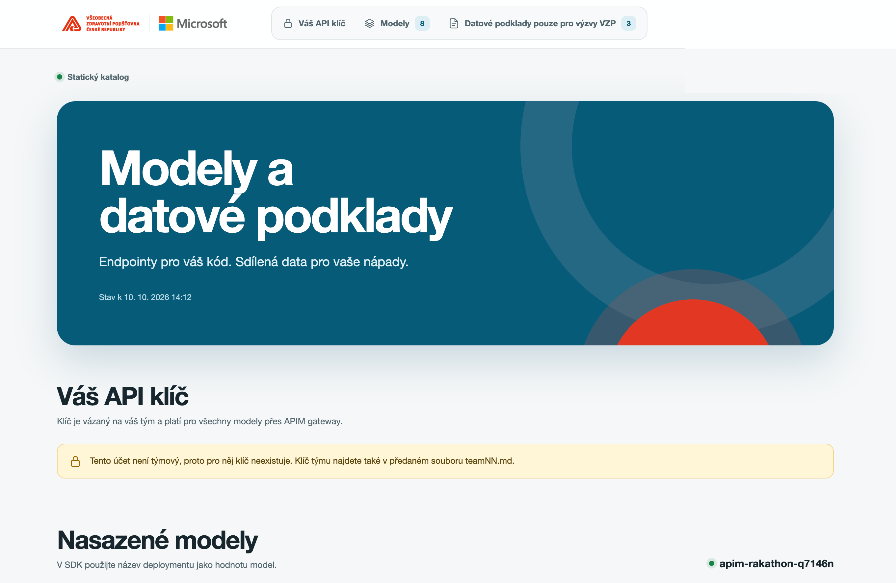

# Rakathon: team newcomer guide

Sign in with your team account, copy your API key, and make your first model call.

**Participant portal:** <https://yellow-mushroom-06f2eb80f.2.azurestaticapps.net/>

[](https://yellow-mushroom-06f2eb80f.2.azurestaticapps.net/)

Scan the QR code or open the URL above, then sign in with your assigned team account.

**Presentation:** open [newcomer-guide.standalone.html](newcomer-guide.standalone.html) in a browser and select **Slides**. The same file contains the full reading guide and works offline; opening the participant portal or calling Azure still needs a connection.

## What your team can use

| Resource | What it gives you | Where to start |
|---|---|---|
| Participant portal | Your team API key, model deployment names, gateway URL, and challenge file list | Participant portal above |
| AI model gateway | Shared text/code models and an image-generation deployment, accessed with your team key | Portal: **Váš API klíč** and **Modely** |
| Challenge data | Read-only data files for VZP challenges | Portal: **Datové podklady pouze pro výzvy VZP** |
| Team workspace | Azure resource group `rg-teamNN`, where your team has Contributor access | <https://portal.azure.com/>: **Resource groups** |

`teamNN` means your assigned team, such as `team01`. Your workspace is not an isolated subscription: manage only your own resource group. Teams do not have direct access to the Microsoft Foundry portal or Agent Service.

The model and file lists are snapshots: check **Stav k** (snapshot date) in the portal. This guide reflects repository configuration reviewed on 12 October 2026, not a live inventory or a guarantee of availability.



Portal screenshot supplied for this guide; account and tenant identifiers are redacted. This example uses a non-team account, so it shows no API key. Use your assigned team account to see your own key.

## Sign in with the account supplied by the organizers

1. Get your private `teamNN.md` handoff from the organizers. It contains your full team username, a Temporary Access Pass (TAP), its validity window, and backup API connection details. Do not put this file in Git or share it outside your team.
2. Open the participant portal. Use a separate browser profile or a private window if Microsoft already has your personal/work account signed in.
3. Enter the full team username from the handoff, not your usual account. At Microsoft's sign-in prompt, use the TAP and follow any authentication setup instructions shown.
4. Check the signed-in username in the portal. Your key should belong to the same `teamNN`.

A TAP is for Microsoft sign-in; it is **not** the model API key. It works only within the handoff's validity window and may be single-use. If it is expired, not yet valid, already used, or you cannot finish sign-in, ask the organizers for help.

## Copy your own team key

1. Open **Váš API klíč** ("Your API key").
2. Check that the team is correct and its state is **aktivní** ("active").
3. Select the copy icon beside **API klíč (hlavička api-key)**. The eye icon reveals or hides the value.
4. Copy **Base URL (OpenAI v1)**. Under **Modely**, expand a model card and copy **Deployment / model v SDK**.

The same team key works across the gateway's model deployments. Keep it in a local secret/environment variable or your application's server-side secret store. Never commit it, paste it into public chat, show it in screenshots, or embed it in browser-side code. The private handoff is a backup if the portal cannot load your key.

The gateway is `https://apim-rakathon-q7146n.azure-api.net/openai/v1`. Send the key in the **`api-key` header**; an `Authorization: Bearer` header alone does not authenticate gateway requests. Do not use a direct Foundry endpoint.

## Make a small first model call

Choose a text deployment in **Modely**. `model` is the **deployment name**, not the display name. For example, the configured `gpt-6-luna` deployment is `gpt-6-luna-dz-eu`; confirm it is listed before using it.

Run this in **Bash**, with `curl` installed. The key prompt does not echo your key or put its literal value into shell history:

```bash
export AZURE_CONFIG_DIR="$HOME/.azure-rak"
read -r -s -p "Team API key: " API_KEY; printf '\n'
export API_KEY
curl --fail-with-body --silent --show-error \
  https://apim-rakathon-q7146n.azure-api.net/openai/v1/chat/completions \
  -H "api-key: $API_KEY" \
  -H "Content-Type: application/json" \
  -d '{"model":"gpt-6-luna-dz-eu","messages":[{"role":"user","content":"Say hello to our hackathon team."}]}'
unset API_KEY
```

A successful request returns JSON with an assistant reply. If you chose another text deployment, replace the `model` value.

For Python, install the `openai` package in your project's environment, then use a masked key prompt:

```python
from getpass import getpass
from openai import OpenAI

client = OpenAI(
    base_url="https://apim-rakathon-q7146n.azure-api.net/openai/v1/",
    api_key="unused",
    default_headers={"api-key": getpass("Team API key: ")},
)
reply = client.chat.completions.create(
    model="gpt-6-luna-dz-eu",
    messages=[{"role": "user", "content": "Say hello to our hackathon team."}],
)
print(reply.choices[0].message.content)
```

The SDK requires `api_key`; `"unused"` is a placeholder, not a credential. The real gateway key goes in `default_headers`.

The configured model families include OpenAI, xAI, DeepSeek, Moonshot AI / Kimi, and Microsoft AI. Image generation uses `/images/generations`, not `/chat/completions`. Not every model supports every API or parameter. Use **EU Data Zone** versus **Global** labels to choose the processing scope allowed for your challenge; do not assume Global processing stays in Europe.

## Download challenge data from Azure Portal

The portal lists data for **VZP challenges**; use it only when relevant and permitted for your challenge.

1. In **Datové podklady pouze pro výzvy VZP**, select **Otevřít storage v portálu** ("Open storage in portal").
2. In Azure Portal, sign in with the same team account. If necessary, switch the directory to the event directory supplied by the organizers.
3. Open storage account `strakathondataq7146n`, then **Containers / Kontejnery** > **data**.
4. Use **Microsoft Entra ID** authentication, select a file, then **Download / Stáhnout**.

The repository's 9 October snapshot lists `Rakathon_Datove_rozhrani.docx`, `Rakhaton2026.csv`, and `Rakhaton2026.zip`. Check the portal's file list for the current published snapshot.

The participant portal does not download files or generate download links. Azure data access is separate from portal sign-in: it requires Reader and Storage Blob Data Reader permissions plus an allowed storage network. If access fails, ask the organizers to check both permissions and your network. Do not request storage account keys or change shared storage settings.

## Build in your team's resource group

In <https://portal.azure.com/>, open **Resource groups** and select your assigned `rg-teamNN`. Your team has Contributor access there, allowing you to create and manage application resources within that group, subject to Azure policies and available quotas. Shared data is read-only, and other teams' groups are outside your workspace.

The shared AI gateway is ready to use; you do not need to deploy your own Foundry resource to make model calls. Agree with your teammates before creating paid resources, and ask the organizers about allowed services and infrastructure costs. The model API budget below is not a spending allowance for arbitrary Azure resources.

## Keep calls small and ask for help early

Repository defaults are **USD 1,000 per team** for model usage, an organizer warning at **90%**, and suspension at the team limit. The shared event limit can stop all teams earlier. The default token quota is **4 million tokens per team per day**, shared across text models. These are configured defaults, not a live balance; the organizers confirm your actual allocation and usage.

Start with short prompts and modest concurrency. Stop retry loops on failures; retry rate limits with a delay and respect `Retry-After` when supplied. Only organizers can restore suspended access.

| Symptom | What to check |
|---|---|
| Microsoft sign-in fails | Full team username, TAP validity/single-use status, and whether the browser selected another account |
| Portal says the account is not a team account | Sign out and use the assigned `teamNN` account |
| Key does not load | Retry or sign in again; use the private handoff as backup and tell the organizers |
| HTTP 401 from the model gateway | Correct `api-key` header, copied key, gateway URL, and active team state; suspension also returns 401 |
| **zablokováno - rozpočet** / suspended | Contact organizers; a new key does not restore suspended access |
| HTTP 404 or unsupported model/parameter | Exact deployment name and the API appropriate to that model |
| HTTP 429 | Rate limit, shared deployment capacity, or token quota; wait rather than loop |
| Storage access denied | Correct account/directory, Reader plus Blob Data Reader permissions, and allowed network |
| Catalog does not load or looks outdated | Ask organizers to check the catalog export and portal deployment |

When asking for help, include your team name, the action or endpoint path, deployment name, HTTP status, time, and a redacted error message. **Never send your TAP or API key.**

**Ready to build:** the right team account, an active gateway key, and one successful model call.

### Configuration references

Participant behavior: [portal source](../web/src/main.ts), [API key examples](../web/src/key.ts), [team provisioning](../infra/rakathon-env/scripts/create-team-users.sh), and [infrastructure overview](../infra/rakathon-env/README.md). Model/file snapshot: [catalog](../web/public/catalog.json), exported 9 October 2026. Budget defaults: [cost control](../infra/rakathon-env/docs/cost-control.md) and [variables](../infra/rakathon-env/shared/variables.tf), reviewed 12 October 2026. These are organizer-maintained repository references; participants do not need to run provisioning scripts.
